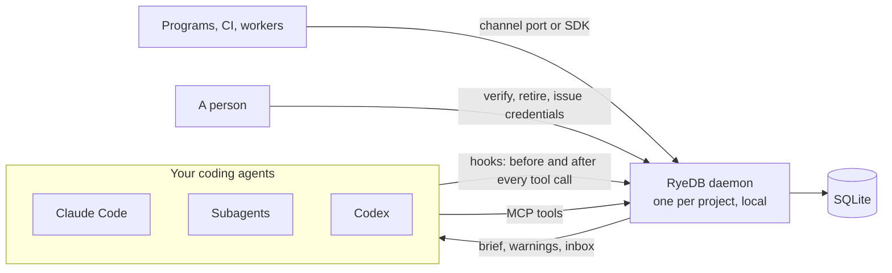

# RyeDB

**Persistent memory and a message channel for coding agents.**

Coding agents lose their place when the context is compacted, repeat approaches that already failed, and start subagents blind. RyeDB keeps project memory in a local database next to your code and puts a small, budgeted brief back into every agent and subagent. A rule a human has verified can stop a tool call before it runs.

## What it does

- **Memory that survives compaction.** Rules, decisions and known failures with their fixes, budgeted into a short brief.
- **Verified versus claimed.** Agents can propose; only a person (or the owner's merge of the project's rules file) can verify, and only verified rules can block.
- **Notes that notice they are stale.** A note that names a file is marked when that file changes. In our test an unmarked note was believed in 6 of 6 runs; the marked one in 0 of 6.
- **RyeChannel.** A persistent, ordered log for agents and programs: tasks that stay open until answered, receipts, presence, per-agent credentials.
- **Local first.** One SQLite file per project, loopback only, no cloud. Hooks answer in well under a millisecond at the median.

## Repositories

| Repository | What it is |
|---|---|
| [`core`](https://github.com/RyeDB/core) | The engine, daemon, hooks, MCP server and CLI. Start here: quickstart, concepts, guides, benchmarks, threat model |
| [`MCP`](https://github.com/RyeDB/MCP) | The MCP server's public home: tool contract, client setup, conformance tests |
| [`SDK`](https://github.com/RyeDB/SDK) | TypeScript client for RyeChannel |
| [`.github`](https://github.com/RyeDB/.github) | This profile, contributing guide, security policy, issue and PR templates |

## Honest status

Early. Works today with Claude Code and Codex on Linux and macOS, on one machine. Not yet: published packages, Windows, hosted sync, team memory, Codex subagent coverage. Every claim about effect is measured on small tests with the raw data and the limits written next to it (see core's `docs/BENCHMARKS.md`), including results that did not favour RyeDB.

Licensed under Apache-2.0. Report a vulnerability through [SECURITY.md](../SECURITY.md).
